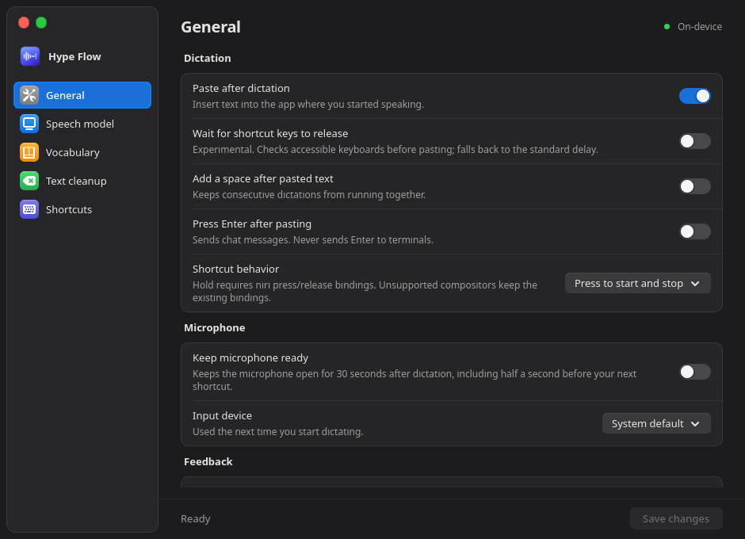
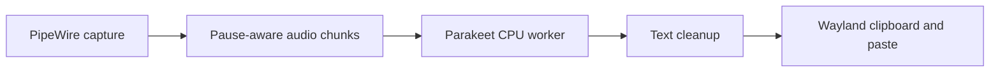

<a id="readme-top"></a>

<div align="center">

<picture>
  
</picture>

# Hype Flow

**Offline English dictation for niri. Speak into your active window.**

[](https://github.com/Dijo-404/hype_flow/actions/workflows/ci.yml)


[Quick start](#quick-start) · [Usage](#usage) · [Documentation](#documentation) · [Contributing](#contributing)

</div>

<br />

<p align="center">
  <picture>
    
  </picture>
</p>

## Overview

Hype Flow is a native Linux dictation app for niri. Press a shortcut, speak, and press it again to paste into the window where you started. Recognition runs locally on the CPU using Parakeet Unified English 0.6B INT8 by default.

### Features

- **Dictate without leaving your app.** The recording capsule keeps focus on your text field. Click it to finish or right-click to cancel.
- **Start at login with a light idle footprint.** The default model takes 663 MB on disk and about 1.2 GB of memory while loaded. The worker loads during your first recording and unloads after 10 idle minutes by default. The 110M models take about 135 MB on disk and 470 MB of memory.
- **Keep your preferred spellings.** Add vocabulary and exact text corrections, filter filler words, and copy the original recognition result whenever you need it.
- **Work with longer dictation.** Capture up to five minutes. Hype Flow prefers pauses when splitting audio and decodes completed pieces while you speak.
- **Choose what stays on disk.** Audio stays in memory by default. Enable history or recovery to keep recent recordings for retry.

## Requirements

| Requirement  | Details                                                                                                             |
| :----------- | :------------------------------------------------------------------------------------------------------------------ |
| **OS**       | Linux x86_64 with a niri Wayland session and a session D-Bus                                                        |
| **Build**    | Current stable Rust, Cargo, Make, a C toolchain, and pkg-config                                                     |
| **Desktop**  | GTK 4.12 or newer, gtk4-layer-shell, PipeWire, wl-clipboard 2.3 or newer, wtype, and bubblewrap                     |
| **Optional** | `playerctl` to pause and resume media, Python 3.11 or newer for evaluation tooling, and PyGObject for desktop tests |

## Installation

On Arch Linux, install the dependencies and build Hype Flow from source.

```bash
sudo pacman -S --needed base-devel git rust gtk4 gtk4-layer-shell pipewire wl-clipboard wtype bubblewrap
git clone https://github.com/Dijo-404/hype_flow.git
cd hype_flow
make install
```

This installs the app, recognizer, and evaluator under `~/.local/bin` and adds **Hype Flow** to your launcher. On other distributions, install the equivalent dependencies from [Requirements](#requirements) before running `make install`.

<details>
<summary><b>Hype Niri installation</b></summary>

<br />

Use the `hype-flow` option in the Hype Niri installer to set up the application, speech model, shortcuts, and background startup. [Hype Niri](https://github.com/Dijo-404/hype_niri)

</details>

### Updating

Pull the latest changes from your checkout and reinstall.

```bash
git pull --ff-only
make install
~/.local/bin/hype-flow --setup
```

Quit the running app with **Ctrl+Q** in its settings window, then reopen it. Setup reuses a compatible model and preserves saved shortcuts. Use **Speech model → Install selected model** to refresh the managed worker or activate a different profile.

### Uninstalling

Quit Hype Flow. Remove the include for the managed `hype-flow.kdl` from your niri config, then remove that managed file. If you added bindings or autostart manually, remove those entries from the config where you added them.

These commands remove the binaries, private library, and launcher from the default install prefix.

```bash
data_home="${XDG_DATA_HOME:-$HOME/.local/share}"
rm -f ~/.local/bin/hype-flow ~/.local/bin/hype-flow-recognizer ~/.local/bin/hype-flow-evaluate
rm -f ~/.local/share/hype-flow/lib/libgtk4-layer-shell.so.0
rm -f "$data_home/applications/dev.hype.Flow.desktop"
rm -f "$data_home/icons/hicolor/scalable/apps/dev.hype.Flow.svg"
```

Settings, model downloads, backups, and recordings remain in the locations listed under [Files it creates](#files-it-creates). Use **General → Delete saved recordings** before uninstalling if you want to clear retained audio.

## Quick start

```bash
~/.local/bin/hype-flow --setup  # Download the model and configure niri shortcuts and autostart.
~/.local/bin/hype-flow          # Open Hype Flow settings from your niri session.
```

1. Focus a text field and press **Alt+Space**.
2. Speak when you hear the start sound.
3. Press **Alt+Space** again to transcribe and paste. Press **Super+Ctrl+Escape** to cancel.

Setup verifies the model and native runtime before activation. You can also set up the model in **Speech model → Install selected model** and add bindings in **Shortcuts → Configure niri**.

## Usage

### Commands

| Command                  | Description                                                                                         |
| :----------------------- | :-------------------------------------------------------------------------------------------------- |
| `hype-flow`              | Open the settings window.                                                                           |
| `hype-flow --setup`      | Install the configured model and configure niri. Works from a terminal without a graphical session. |
| `hype-flow --background` | Start without opening settings.                                                                     |
| `hype-flow --toggle`     | Start recording or finish the current recording.                                                    |
| `hype-flow --cancel`     | Cancel recording or inference.                                                                      |
| `hype-flow --help`       | Show the GApplication command-line options.                                                         |

### Keybindings

| Key                   | Action                                     |
| :-------------------- | :----------------------------------------- |
| **Alt+Space**         | Start or finish recording.                 |
| **Super+Ctrl+Escape** | Cancel dictation.                          |
| **Ctrl+W**            | Close settings and keep dictation running. |
| **Ctrl+Q**            | Quit Hype Flow.                            |

To change a shortcut, click **Dictate** or **Cancel** under **Shortcuts**, press the new combination, and choose **Save changes**. Hype Flow validates the niri config, rejects conflicting bindings, and backs up the affected files. **Hold** mode requires a niri build that supports native press and release bindings.

When a compatible Hype Niri notch is running, it shows recording state and provides dictate, cancel, copy-last, and settings controls. The built-in capsule is available on other niri setups.

### Examples

**Correct the way a name is written.** In **Text cleanup**, add one literal correction per line. Matching ignores case and uses whole words or phrases.

```text
open ai => OpenAI
```

Choose **Copy original** under **General** to recover text before cleanup. Default filler filtering removes `um`, `uh`, `erm`, `umm`, and `uhh`. Near-miss corrections, spoken commands, number formatting, and repeated-word removal are available as opt-in controls.

**Switch speech models.** In **Speech model**, choose **110M TDT** or **110M CTC** for lower memory and latency, save, and select **Install selected model**. Your active model remains in use until installation succeeds. Unified also supports optional native vocabulary boosting.

## Configuration

Settings live at `~/.config/hype-flow/config.toml` by default. Every key is optional. Use the settings window for common options, including microphone selection, paste behavior, start and stop sounds, and **Keep microphone ready**. That last option keeps the microphone open for 30 seconds after a dictation and can include audio from up to half a second before the next shortcut.

```toml
model_variant = "unified"
dictation_shortcut = "Alt+Space"
unload_minutes = 10
```

See the [annotated config](docs/config.toml) for all options and defaults and the [niri snippet](docs/niri.kdl) for manual bindings.

### Environment variables

| Variable          | Effect                                                                                      |
| :---------------- | :------------------------------------------------------------------------------------------ |
| `XDG_CONFIG_HOME` | Settings base directory. Defaults to `~/.config`.                                           |
| `XDG_DATA_HOME`   | Models, native runtime, and launcher assets. Defaults to `~/.local/share`.                  |
| `XDG_STATE_HOME`  | Root for opt-in recording retention. Defaults to `~/.local/state`.                          |
| `XDG_RUNTIME_DIR` | Required by the desktop app for private runtime files. Your session sets it.                |
| `NIRI_CONFIG`     | Override which niri config setup and shortcut changes modify.                               |

### Files it creates

| Path                              | Contents                                                                                                    |
| :-------------------------------- | :---------------------------------------------------------------------------------------------------------- |
| `~/.config/hype-flow/config.toml` | Preferences. Model activation saves the previous config as `config.toml.previous`.                          |
| `~/.config/niri/hype-flow.kdl`    | Managed bindings and autostart. Setup adds an include and saves timestamped backups beside the niri config. |
| `~/.local/share/hype-flow/`       | Speech models, inference runtime, and setup cache.                                                          |
| `$XDG_RUNTIME_DIR/hype-flow/`     | Latest original and cleaned transcripts and `backend.log`.                                                  |
| `~/.local/state/hype-flow/`       | Opt-in recovery and history audio. Each collection keeps its latest 20 recordings.                          |

## Privacy and safety

- Setup downloads and checksum-verifies the selected speech assets. Recognition runs locally. The worker uses a bubblewrap network namespace when available. Check `$XDG_RUNTIME_DIR/hype-flow/backend.log` for its sandbox status.
- The latest transcripts are stored in mode-0600 runtime files until app exit or replacement. The notch receives recording state and microphone levels over session D-Bus. Transcript text stays with Hype Flow.
- Hype Flow marks clipboard writes as sensitive. Clipboard managers may retain copied text. After automatic paste, Hype Flow restores the previous clipboard and, for supported editors, the primary selection unless they changed. Copy-only delivery leaves the transcript on the clipboard.
- **Retry last failed** and **Retry recent recording** copy the result for review. Switch off both retention options to stop saving audio. Use **Delete saved recordings** to remove existing recordings.
- An optional executable at `~/.config/hype-flow/transcript-hook` receives cleaned text on standard input. Its output replaces the paste text. The file must belong to you and be writable only by you. A failure or 30-second timeout falls back to the cleaned text.

## How it works



The app sends PCM audio to the Rust worker through anonymous pipes. It decodes completed pieces during capture and processes the final piece when you stop. The default CTC profile preserves internal pauses and uses a fixed 32 ms lead-in when silence cutting is enabled. After cleanup, Hype Flow returns focus to the original window and verifies it before pasting. If that window closed, Hype Flow copies the transcript.

## Tech stack

| Component                  | Tool                                                                                              |
| :------------------------- | :------------------------------------------------------------------------------------------------ |
| **Application and worker** | [Rust](https://www.rust-lang.org/)                                                                |
| **Desktop and capsule**    | [GTK 4](https://www.gtk.org/) and [GTK4 layer shell](https://github.com/wmww/gtk4-layer-shell)    |
| **Capture**                | [PipeWire](https://pipewire.org/)                                                                 |
| **Inference**              | [sherpa-onnx](https://github.com/k2-fsa/sherpa-onnx)                                              |
| **Clipboard and typing**   | [wl-clipboard](https://github.com/bugaevc/wl-clipboard) and [wtype](https://github.com/atx/wtype) |

## Project structure

```text
.
├── src/       # Desktop app, dictation pipeline, and evaluator
├── worker/    # Rust inference worker and pinned native bindings
├── assets/    # Embedded stylesheet, logo, and common-word list
├── tools/     # Installer, binding generator, and evaluation tools
├── tests/     # Rust and Python checks, fixtures, and desktop drivers
├── docs/      # Configuration, evaluation results, and provenance
└── README.md
```

## Development

Install the build dependencies, then run the test and build targets.

```bash
make check          # Rust tests, rustfmt, and Clippy.
make check-python   # Python unit tests and bytecode compilation.
make release        # Build release binaries for installation.
```

Run these additional checks with Ruff, Prettier, ShellCheck, shfmt, Tombi, and actionlint installed.

```bash
ruff check tests tools
ruff format --check tests tools
git ls-files -z -- '*.md' '*.json' '*.yml' '*.yaml' '*.css' | xargs -0 prettier --check
shellcheck tools/*.sh
shfmt -i 4 -d tools
tombi format --check Cargo.toml worker/Cargo.toml docs/config.toml docs/eval.toml
actionlint
```

Run `make check-desktop` inside a controlled Wayland compositor and an isolated D-Bus session. The harness uses synthetic audio and its own GTK paste target. For direct Cargo commands, add `~/.local/lib/pkgconfig` to `PKG_CONFIG_PATH` if you installed GTK4 layer shell there.

To compare recognition results, supply mono 16 kHz PCM16 WAV files and a JSONL manifest with paths relative to it. Run `hype-flow-evaluate recordings.jsonl --max-wer 0.05` to check the cleaned word error rate. See the [evaluation guide](docs/eval-results/README.md) for the manifest format, corpus setup, and metric definitions.

## Troubleshooting

<details>
<summary><b>Alt+Space starts dictation in VS Code, but the text never appears</b></summary>

<br />

Set `"window.customMenuBarAltFocus": false` in VS Code. Releasing Alt can otherwise focus the menu bar. You can also assign a shortcut that avoids Alt in **Shortcuts**.

</details>

<details>
<summary><b>Shortcuts fail to install</b></summary>

<br />

Confirm that the niri config exists and that the shortcuts are free. If the error refers to native press and release bindings, select **Toggle** mode. If you manage your config by hand, use the [niri snippet](docs/niri.kdl).

</details>

<details>
<summary><b>The app asks for a model or worker update</b></summary>

<br />

Open **Speech model** and select **Install selected model**. Setup reuses a verified archive when it can. For a model or worker configured at a custom path, repair it in place or switch to a managed profile.

</details>

## Limitations

- The supplied speech profiles support English. The bundled inference runtime targets Linux x86_64.
- Recordings shorter than 300 ms are rejected. A muted microphone reports digital silence separately from speech detection.
- Entry into custom text fields and embedded terminals depends on their clipboard shortcuts. Supported editors use **Shift+Insert**, known terminals use **Ctrl+Shift+V**, and other apps use **Ctrl+V**. Disable automatic paste if your target needs a different route.
- Vocabulary boosting and the optional noise and confidence controls can affect accuracy and latency. Use your own recordings to compare settings. [Benchmark results](docs/eval-results/README.md)

## Documentation

| Guide                                                  | What's in it                                       |
| :----------------------------------------------------- | :------------------------------------------------- |
| [Configuration](docs/config.toml)                      | Settings and their defaults                        |
| [niri integration](docs/niri.kdl)                      | Manual bindings and login startup                  |
| [Evaluation](docs/eval-results/README.md)              | Reproduction steps, metrics, and benchmark results |
| [Implementation status](docs/status.md)                | Verification evidence and open work                |
| [Provenance](docs/third-party.md)                      | Models, runtimes, and third-party notices          |

## Contributing

Issues and pull requests are welcome. Include the app revision, niri version, and reproduction steps in bug reports. Run `make check` and `make check-python` before opening a pull request. [GitHub Issues](https://github.com/Dijo-404/hype_flow/issues)

## License

Project-wide licensing is unspecified. The model, runtime, and reused components have their own terms and notices. [Third-party notices](docs/third-party.md)

## Acknowledgements

- [NVIDIA Parakeet](https://github.com/NVIDIA/NeMo) and [sherpa-onnx](https://github.com/k2-fsa/sherpa-onnx) for the recognition models and runtime.
- [OpenWhispr](https://github.com/OpenWhispr/openwhispr) for references on segmentation and editor paste routing.
- [Handy](https://github.com/cjpais/Handy) for the focus-preserving recording overlay reference.

<br />

<div align="center">
  <sub>Built by <a href="https://github.com/Dijo-404">Dijo-404</a> · <a href="#readme-top">Back to top</a></sub>
</div>
